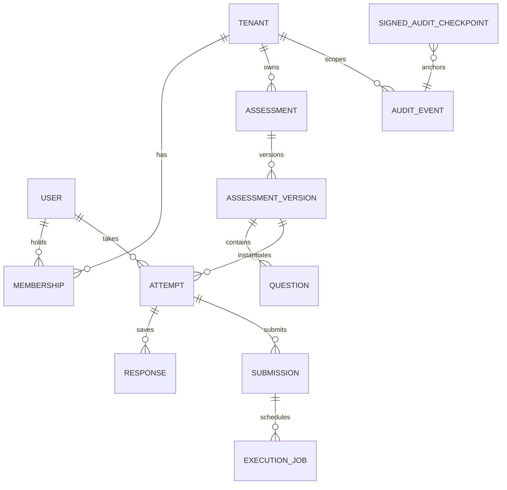

# LANCAST — Phase 1 Data Model & ERD

**Version:** 1.0  
**Status:** Phase 1 foundation  
**Authoritative Store:** PostgreSQL (local container by default; portable via `DATABASE_URL`).

## 1. Core Entity-Relationship Diagram

## 2. Core Entities & Invariants

| Entity | Primary Key | Key Columns & Constraints |
|---|---|---|
| `tenants` | `id` (UUID) | `slug` (unique), `name`, `is_active`, `created_at` |
| `users` | `id` (UUID) | `email` (unique), `password_hash`, `full_name`, `is_platform_admin`, `is_active`, `created_at` |
| `memberships` | `id` (UUID) | `tenant_id` (FK), `user_id` (FK), `role` (`tenant_admin`, `organizer`, `candidate`), unique `(tenant_id, user_id)` |
| `assessments` | `id` (UUID) | `tenant_id` (FK), `title`, `description`, `status` (`draft`, `published`, `active`, `closed`, `archived`), `created_by` (FK), `created_at` |
| `assessment_versions` | `id` (UUID) | `tenant_id` (FK), `assessment_id` (FK), `version_number` (unique per assessment), `config_json`, `canonical_digest` (SHA-256), `is_frozen`, `published_at` |
| `questions` | `id` (UUID) | `tenant_id` (FK), `assessment_version_id` (FK), `question_type` (`mcq`, `multiple_select`, `descriptive`, `file_upload`, `coding`), `position`, `prompt_json`, `hidden_eval_json`, `max_score` |
| `attempts` | `id` (UUID) | `tenant_id` (FK), `assessment_version_id` (FK), `candidate_id` (FK), `status` (`in_progress`, `submitted`, `expired`, `flagged`), `started_at`, `deadline_at`, `submitted_at` |
| `responses` | `id` (UUID) | `tenant_id` (FK), `attempt_id` (FK), `question_id` (FK), `payload_json`, `idempotency_key`, `saved_at`, unique `(attempt_id, question_id)` |
| `submissions` | `id` (UUID) | `id`, `tenant_id` (FK), `attempt_id` (FK), `idempotency_key` (unique per attempt), `status` (`queued`, `evaluating`, `scored`, `failed`), `score`, `submitted_at` |
| `execution_jobs` | `id` (UUID) | `tenant_id` (FK), `submission_id` (FK), `question_id` (FK), `language`, `priority_class`, `status` (`queued`, `dispatched`, `running`, `completed`, `timed_out`, `failed`), `worker_id`, `queued_at`, `completed_at` |
| `audit_events` | `sequence_num` (BIGSERIAL) | `id` (UUID), `tenant_id` (nullable FK for platform events), `actor_id`, `action`, `resource_type`, `resource_id`, `reason_code`, `policy_version`, `metadata_json`, `prev_hash`, `event_hash`, `created_at` |
| `signed_audit_checkpoints` | `id` (UUID) | `up_to_sequence` (BIGINT), `root_hash`, `signature_ed25519`, `key_id`, `created_at` |

## 3. Security & Integrity Invariants
1. **Tenant Scoping (`FR-TEN-02`, `FR-TEN-03`):** Every tenant-owned table carries `tenant_id` (indexed). Server-side authorization derives tenant scope from authenticated `memberships`, never from client-supplied tenant IDs.
2. **Immutable Active Config (`FR-AS-03`, `FR-SEC-09`):** Once an `assessment_version` is published and frozen, `config_json` and `canonical_digest` are immutable; active `attempts` pin `assessment_version_id`.
3. **Server-Side Secrets (`FR-MOD-05`):** `questions.hidden_eval_json` (correct answers, hidden coding test cases) is never serialized into candidate API responses.
4. **Replay-Resistant Submissions (`FR-ATT-04`, `FR-SEC-05`):** `submissions` enforces a unique constraint on `(attempt_id, idempotency_key)` and validates attempt state transitions server-side.
5. **Tamper-Evident Audit (`FR-SEC-10`, `FR-SEC-11`):** `audit_events` is append-oriented with `prev_hash` -> `event_hash` linking and periodic `signed_audit_checkpoints` signed using an external Ed25519 key.
