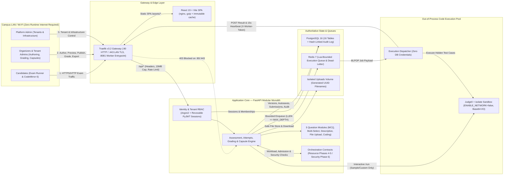

# LANCAST — System Diagrams (High-Level & Detailed Architecture)

This document maintains editable **Mermaid** diagrams alongside the rendered architecture figures for **LANCAST** (*Phases 1–3 implemented core + planned Phases 4–6 telemetry and adaptive/security orchestration planes*).

---

## 1. High-Level Component Interaction Diagram

### Interaction Flow Key
1. **LAN Access & Edge Protection:** All browsers hit Traefik (`:80` dev or `:443` offline private-CA TLS). Traefik serves cached/gzipped React SPA bundles from `nginx`, injects security headers (`nosniff`, `DENY`), enforces 15 MB body and per-IP rate limits, and blocks `/api/internal/*` (`403`) on candidate/organizer ports.
2. **Server-Authoritative Exam Loop:** `apps/api` validates JWT sessions + tenant memberships in PostgreSQL, enforces frozen `AssessmentVersion` SHA-256 digests, persists idempotent `client_seq` autosaves, and writes hash-linked `audit_events`.
3. **Interactive vs. Graded Execution Separation:** Candidate **Run Code** runs synchronously on `Judge0CodeRunner` against *public sample cases or custom stdin only*. Submitted attempts push hidden-test jobs onto the Lua-bounded Redis queue; the credential-free `dispatcher` pulls jobs via `BLPOP`, executes them inside isolated `Judge0`/`isolate` sandboxes, and returns pass/fail verdicts + heartbeats over `:8081` / internal Docker network with `X-Worker-Token`.

---

## 2. Detailed System Architecture Diagram

```mermaid
flowchart TB
    subgraph L1["Untrusted Campus LAN Clients"]
        C1["Candidate Browser (Offline CodeMirror 6, No IntelliSense)"]
        O1["Organizer / Tenant Admin Browser"]
        A1["Platform Admin Browser"]
    end

    subgraph L2["Edge & Gateway (Network: lancast_edge)"]
        TRF["Traefik v3.2 Gateway (traefik.yml, routes.yml, compose.tls.yml)"]
        MW["Middlewares: security-headers, body-limit (15MB), rate-limit, block-internal"]
        NGX["nginx:1.27-alpine (apps/web React 19 SPA, gzip, 1y cache)"]
        TRF --- MW
    end

    subgraph L3["Application Pool (Standalone: 1x | Central: API_REPLICAS >= 2) — Networks: edge + internal + execution"]
        subgraph ROUTERS["FastAPI Routers (apps/api/app/routers/)"]
            R1["/api/auth/* (Register/Bootstrap, Login, Logout, Me)"]
            R2["/api/tenants/* (Tenants & Memberships)"]
            R3["/api/tenants/{tid}/assessments/* & /uploads/* & /capsules/*"]
            R4["/api/me/* & /api/attempts/* (Autosave, Upload, /run, Submit)"]
            R5["/api/admin/infrastructure & /api/health & /api/ready"]
            R6["/api/internal/* (Job Results & Worker Heartbeats — X-Worker-Token)"]
        end

        subgraph SERVICES["Domain Services & Plug-In Modules (apps/api/app/services/)"]
            S1["Security & Tenancy: Argon2 pwdlib, PyJWT, Membership RBAC, SHA-256 Audit Chain"]
            S2["Assessment Lifecycle, Version Digest Verifier, ZIP Capsule Parser"]
            S3["Question Modules: mcq, multiple_select, descriptive, file_upload, coding"]
            S4["Judge0CodeRunner (base64, Sample/Custom) & RedisExecutionQueue (Lua LLEN Guard)"]
            S5["Contracts Ready: WorkloadDescriptor, AdmissionDecision, SecurityContext (Phases 4-6)"]
        end
    end

    subgraph L4["Authoritative Data Plane (Network: lancast_internal ONLY)"]
        PG["PostgreSQL 16 (Alembic 0001..0003: 16 Tables incl. worker_nodes & audit_events)"]
        RD["Redis 7 AOF (lancast:execution:queue, lancast:execution:dead)"]
        VOL["uploads_data Volume (/var/lib/lancast/uploads/{tenant_id}/{attempt_id}/{uuid}.{ext})"]
    end

    subgraph L5["Isolated Execution Plane (Network: lancast_execution | Central: worker_internal on Lab Nodes)"]
        DISP["execution/dispatcher/worker.py (Zero DB Creds, 15s Heartbeats, Dead-Letter Fallback)"]
        SBX["execution/dispatcher/sandbox.py (base64_encoded=true, JS/Java RLIMIT_AS Floors)"]
        J0S["judge0-server:1.13.1 (privileged isolate, ENABLE_NETWORK=false, mem_limit 1.5GB)"]
        J0W["judge0-worker:1.13.1 (privileged isolate, RLIMIT_AS ceiling 8388608 KB)"]
        J0D["judge0-db (Postgres 16) & judge0-redis (Redis 7)"]
        DISP --- SBX
        SBX --> J0S
        J0S --> J0W
        J0S --> J0D
        J0W --> J0D
    end

    subgraph L6["Operations & Planned Research Control Plane"]
        OPS["Ops Scripts: generate-lan-certs.sh, backup.sh, restore.sh, smoke-test.sh"]
        OBS["Planned Phases 4-6: Prometheus/Grafana Exporters, Adaptive Scheduler, Ed25519 Checkpoints"]
    end

    C1 -->|":80 / :443 HTTPS"| TRF
    O1 -->|":80 / :443 HTTPS"| TRF
    A1 -->|":80 / :443 HTTPS"| TRF

    TRF -->|"/"| NGX
    TRF -->|"/api/*"| ROUTERS
    DISP -->|"Central :8081 /api/internal/*"| TRF
    DISP -->|"Standalone HTTP http://api:8000"| R6

    ROUTERS --> SERVICES
    S1 --> PG
    S2 --> PG
    S3 --> VOL
    S4 --> RD
    S4 --> J0S

    RD -->|"BLPOP Jobs"| DISP
    S5 -.->|"Future Telemetry, Admission & Risk Signals"| OBS
    OPS -.->|"pg_dump + tar + SHA256SUMS & SAN TLS Certs"| TRF
    OPS -.-> PG
```

