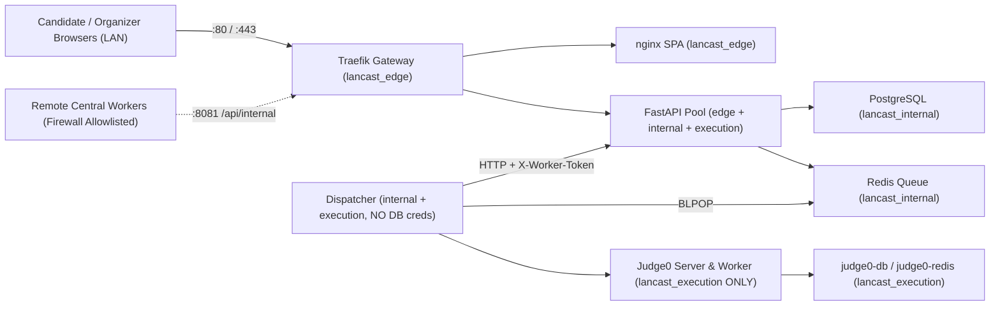

# Phase 3 — Infrastructure and Deployment

**Status:** Complete | **Exit Condition:** Standalone and central deployment profiles deploy reproducibly with network segmentation, container resource/privilege limits, Traefik gateway hardening & offline LAN HTTPS, worker health visibility, backup/restore runbooks, and `O-03` Judge0 audit completed.

---

## 1. Objectives & Traceability

- **Deployment Profiles:** `DEP-01..07`, `NFR-PORT-01`, `ADR-001`, `ADR-002`
- **Gateway & Offline LAN TLS:** `O-05`, `ADR-003`, `T09`, `T11`, `NFR-SEC-01..03`
- **Execution Isolation & Secret Separation:** `O-03`, `FR-CODE-01..05`, `NFR-SEC-04`, `T07`, `T08`, `T19`
- **Admin Visibility & Recovery:** `FR-ADM-01..02`, `NFR-REL-01..03`, `T17`, `T18`

---

## 2. Network Segmentation & Container Hardening

Updated [docker-compose.yml](../../docker-compose.yml), [docker-compose.coding.yml](../../docker-compose.coding.yml), and [apps/web/nginx.conf](../../apps/web/nginx.conf):

- **Three isolated bridge networks:**
  - `lancast_edge`: `traefik`, `web`, `api`
  - `lancast_internal`: `api`, `postgres`, `redis` (and `dispatcher` in Standalone)
  - `lancast_execution`: `api`, `dispatcher`, `judge0-server`, `judge0-worker`, `judge0-db`, `judge0-redis` (cannot route to `postgres` or `traefik`; `T08`, `T19`)
- **Container limits:** Added `mem_limit`, `cpus`, `pids_limit`, and `security_opt: [no-new-privileges:true]` to all non-privileged containers (`traefik`, `web`, `api`, `postgres`, `redis`, `dispatcher`, `judge0-db`, `judge0-redis`), physical `mem_limit: 1536m` / `cpus: "2.0"` on `judge0-server` and `judge0-worker`, an HTTP `healthcheck` on `api`, and gzip compression in `apps/web/nginx.conf`.

---

## 3. Reproducible Deployment Profiles (`infrastructure/profiles/`)

Both profiles run identical `apps/api`, `apps/web`, and `execution` images (`DEP-03`):

| Profile | Files | Topology & Placement |
|---|---|---|
| **Standalone** | [compose.standalone.yml](../../infrastructure/profiles/standalone/compose.standalone.yml), [.env.standalone.example](../../infrastructure/profiles/standalone/.env.standalone.example) | Single server running Traefik, `web`, 1 `api`, `postgres`, `redis`, and optional coding stack (`docker-compose.coding.yml`) with `json-file` log rotation and `ENVIRONMENT=production`. |
| **Central Server** | [compose.server.yml](../../infrastructure/profiles/central/compose.server.yml), [.env.server.example](../../infrastructure/profiles/central/.env.server.example) | Central server running Traefik (`:80`/`:443` + `WORKER_BIND_IP:8081` worker entrypoint), single gzipped `web`, horizontally scaled `api` pool (`API_REPLICAS`, default `2`), `postgres` (or external `DATABASE_URL`), and Redis bound to `WORKER_BIND_IP:6379`. |
| **Central Remote Worker** | [compose.worker.yml](../../infrastructure/profiles/central/compose.worker.yml), [.env.worker.example](../../infrastructure/profiles/central/.env.worker.example) | Separate campus worker machine running `dispatcher` + local `judge0-*` on `worker_internal`. Connects only to Central Redis and Central Traefik `:8081/api/internal/*` via `X-Worker-Token`; holds **zero** LANCAST PostgreSQL credentials. |

[.gitignore](../../.gitignore) tracks `!.env.example` and `!.env.*.example` templates while excluding `.env`, `.env.*`, `infrastructure/gateway/certs/`, `secrets/`, and `backups/`. Local gitignored `.env.standalone`, `.env.server`, and `.env.worker` were synced from the local root `.env` (`chmod 600`).

---

## 4. Traefik Gateway Hardening & Offline LAN HTTPS (`O-05`)

- **Entrypoints & Middlewares ([traefik.yml](../../infrastructure/gateway/traefik.yml), [routes.yml](../../infrastructure/gateway/dynamic/routes.yml)):**
  - `security-headers`: `X-Content-Type-Options: nosniff`, `X-Frame-Options: DENY`, `Referrer-Policy: strict-origin-when-cross-origin`, `Permissions-Policy: camera=(), microphone=(), geolocation=()`.
  - `body-limit`: 15 MB `maxRequestBodyBytes` ceiling (`15728640`, `T09`).
  - `rate-limit`: baseline `average: 100`, `burst: 200`, `period: "1s"` (`T09`).
  - `/api/internal/*` blocked with `403` on candidate/organizer `:80` and `:443`, and routed only on the firewall-restricted `:8081` `worker` entrypoint (`worker-internal-router`).
- **Offline LAN HTTPS ([compose.tls.yml](../../infrastructure/gateway/compose.tls.yml), [tls.yml](../../infrastructure/gateway/tls-dynamic/tls.yml), [tls-routes.yml](../../infrastructure/gateway/tls-dynamic/tls-routes.yml), [generate-lan-certs.sh](../../infrastructure/scripts/generate-lan-certs.sh)):**
  - Generates a local private LAN CA (`lancast-ca.crt`) and SAN-signed server certificate (`lancast.crt`/`lancast.key`) using standard `openssl` with zero Internet/ACME dependency.
  - Note: mounting `routes.yml` as a file (instead of directory-mounting `dynamic:ro`) allows `compose.tls.yml` to layer `tls.yml` and `tls-routes.yml` cleanly into `/etc/traefik/dynamic/`.

---

## 5. Worker Registry, Heartbeats & Admin Infrastructure Panel (`FR-ADM-01..02`)

- **Database & Migration:** Added `WorkerNode` ORM model in [models.py](../../apps/api/app/db/models.py#L244-L258) and migration [0003_worker_registry.py](../../apps/api/alembic/versions/0003_worker_registry.py) (`worker_nodes` table indexed on `last_heartbeat_at`).
- **API Endpoints:**
  - `POST /api/internal/workers/heartbeat` in [internal.py](../../apps/api/app/routers/internal.py#L62-L101) (`X-Worker-Token`-authenticated upsert marking nodes `online` or `degraded` from `judge0_ok`).
  - `GET /api/admin/infrastructure` in [admin.py](../../apps/api/app/routers/admin.py) (`PlatformAdmin`-only, registered in [main.py](../../apps/api/app/main.py#L32); schemas in [infrastructure.py](../../apps/api/app/schemas/infrastructure.py)): returns `deployment_profile`, `environment`, `postgres`/`redis`/`judge0` health, Redis queue & dead-letter depths, and worker nodes with automatic stale detection (`last_heartbeat_at > 45s` -> `status="offline"`, `stale=True`).
- **Dispatcher Heartbeats ([execution/dispatcher/worker.py](../../execution/dispatcher/worker.py)):** Emits startup, 15s periodic, and post-job heartbeats probing Judge0 `/about`, resilient to transient API outages (`NFR-REL-01`).
- **Admin UI ([apps/web/src/pages/AdminPage.tsx](../../apps/web/src/pages/AdminPage.tsx), [api.ts](../../apps/web/src/lib/api.ts), [StatusBadge.tsx](../../apps/web/src/components/StatusBadge.tsx)):** Added **Infrastructure & Execution Workers** summary cards and live worker status table.

---

## 6. Operational Scripts, CI & Documentation

- **Scripts (`infrastructure/scripts/`):**
  - [backup.sh](../../infrastructure/scripts/backup.sh): Dumps PostgreSQL (`pg_dump -Fc`), archives `uploads_data`, records `metadata.txt`, and generates `SHA256SUMS`.
  - [restore.sh](../../infrastructure/scripts/restore.sh): Verifies `SHA256SUMS`, supports safe non-destructive verification (`--target-db <name>`) as well as primary restore + `alembic upgrade head`.
  - [smoke-test.sh](../../infrastructure/scripts/smoke-test.sh): Verifies `/api/health` (`200`), `/api/ready` (`200`), SPA `/` (`200`), `/api/internal` (`403`), and required security headers (supports `--url` & `--cacert`).
- **CI ([.github/workflows/ci.yml](../../.github/workflows/ci.yml)):** Validates `docker-compose.yml`, coding override, `standalone`, `central/server`, `central/worker`, and `compose.tls.yml`.
- **Docs:** [judge0-isolation-audit.md](../infrastructure/judge0-isolation-audit.md) (closes `O-03`) and [deployment-guide.md](../infrastructure/deployment-guide.md) (profiles, LAN TLS, host firewall rules, external DB option, `DEP-06` audit, recovery runbook).

---

## 7. Verification Evidence

- **Tests & Build:**
  - `apps/api`: `uv run ruff check app tests alembic` (0 errors); `uv run pytest -q` (**76/76 passed**, including `test_infrastructure.py`).
  - `execution`: `uv run ruff check dispatcher tests` (0 errors); `uv run pytest -q` (**7/7 passed** including heartbeat & Judge0 health checks).
  - `apps/web`: `npm test` (**5/5 Vitest passed**); `npm run build` (`tsc -b && vite build`) clean.
- **Database Migration Round-Trip (PostgreSQL 16):** `alembic upgrade head -> downgrade base -> upgrade head -> alembic check` completed with zero schema drift.
- **Compose Profile Validation:** `docker compose --env-file ... config --quiet` passed for default, coding, `standalone`, `central/server`, `central/worker`, and `compose.tls.yml`.
- **Live Operational Proofs:**
  - **Offline LAN HTTPS (`:443`):** `generate-lan-certs.sh` + `compose.tls.yml` served `HTTP/2 200` on `https://localhost/api/health` with `x-content-type-options: nosniff` and `x-frame-options: DENY`, and `403` on `/api/internal/*` across both HTTP and HTTPS.
  - **Live Worker Heartbeat:** `GET /api/admin/infrastructure` reported `postgres: ok`, `redis: ok`, `judge0: ok`, and `dispatcher-1` `online` (`judge0_ok: true`, `stale: false`).
  - **Smoke Test & Backup/Restore:** `smoke-test.sh` passed all checks; `backup.sh` -> `restore.sh --target-db lancast_restore_test --yes` passed `SHA256SUMS` and restored DB tables cleanly (`tenants_restored: 1`).
